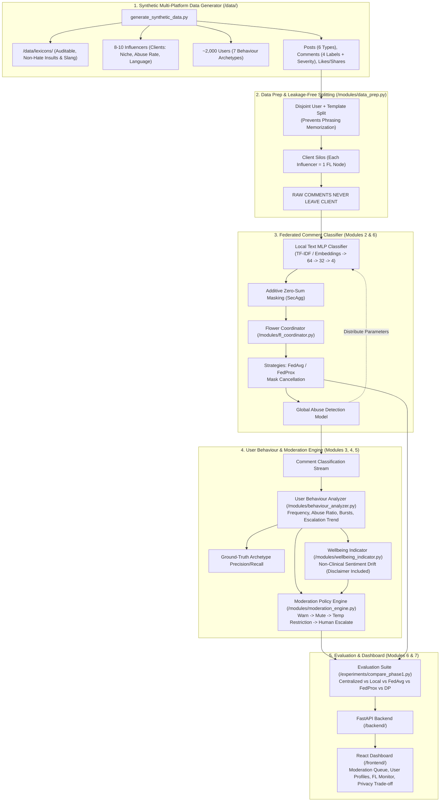

# Audit & Refactor Plan: Pivoting to Abuse Detection & User Behaviour Moderation

**Project Title:** Privacy-Preserving Federated Learning for Social Media Influencer  
**Date:** October 30, 2026  
**Candidate:** D K Karthikesh (USN: 1BY25MC034)  
**Guide:** Prof Reshma C R  

---

## 1. Executive Summary & Pivot Rationale

The project scope is pivoting from **engagement score regression & content recommendation** to:
> **Analysing user behaviour on influencers' posts, detecting abusive/vulgar vs positive comments, identifying repeat abusers, and recommending graded moderation actions, while raw comments never leave their client (each influencer's community is one federated client).**

This pivot aligns the technical contribution with modern community safety, online wellbeing, and decentralized content moderation, while maintaining the exact project title and core federated learning architecture.

---

## 2. Repo Audit: Keep, Archive, and Refactor Matrix

| Existing File / Component | Audit Finding | Action | Target Destination / Refactor Plan |
| :--- | :--- | :---: | :--- |
| `data/generate_dataset.py` | Generates likes/shares/engagement score for regression. | **Archive** | Move to `archive/legacy_engagement/generate_dataset.py`. |
| `data/social_media_engagement.csv` | Old engagement regression dataset. | **Archive** | Move to `archive/legacy_engagement/`. |
| `data/generate_synthetic_data.py` | Does not exist yet. | **Create** | New generator: 8–10 influencers (clients), ~2,000 users with 7 archetypes, multi-platform posts, comments with text + labels + severity, likes/shares events, realism guards. |
| `data/lexicons/` | Does not exist yet. | **Create** | Modifiable lexicon files (`positive.json`, `neutral.json`, `criticism.json`, `insults.json`, `profanity.json`, `hinglish_kannada_slang.json`). |
| `modules/data_prep.py` | Contains tabular scaling & client partitioning for regression. | **Refactor** | **Keep client partitioning & data locality concept**. Replace tabular engagement scaler with text tokenization / TF-IDF vectorization, user/template disjoint train-test splitting, and per-influencer partitioner. |
| `modules/local_model.py` | Contains `NumPyEngagementMLP` (regression d->64->32->1) & XGBoost regressor. | **Refactor** | **Keep zero-DLL architecture**. Refactor into `CommentClassifierMLP` ($V \to 64 \to 32 \to 4$) with CrossEntropy / Softmax for 4-class comment classification (Positive, Neutral, Constructive Criticism, Abusive-Vulgar) + severity head. Archive XGBoost regressor. |
| `modules/fl_coordinator.py` | Flower NumPyClient simulation with local fit/evaluate & server aggregation. | **Keep & Reuse** | Retain core Flower simulation engine and round aggregation logic. Update client task from regression loss to multi-class CrossEntropy classification metrics (macro-F1, Precision, Recall, ROC-AUC). |
| `modules/strategies.py` | Contains `FedAvgStrategy` and `FedProxStrategy`. | **Keep & Reuse** | 100% reusable for classification weights aggregation and proximal regularization $\mu$. |
| `modules/behaviour_analyzer.py` | Does not exist yet. | **Create** | New Module 3: Computes user frequency, negative/abusive ratio, burst windows, escalation trends, repeat offences, and composite risk score. |
| `modules/wellbeing_indicator.py` | Phase II module. | **Plan** | New Module 4: Sentiment drift & non-clinical wellbeing risk signal with mandatory medical disclaimer. |
| `modules/moderation_engine.py` | Phase II module. | **Plan** | New Module 5: Graded policy engine (warn -> rate-limit -> temporary restriction -> human review). |
| `modules/secure_aggregation.py` | Phase II module. | **Plan** | New Module 6: Additive pairwise zero-sum masking for classification gradients. |
| `modules/dp_privacy.py` | Phase II module. | **Plan** | New Module 6: Client-level calibrated Gaussian noise and DP accountant $(\epsilon, \delta)$. |
| `experiments/run_centralized.py` | Evaluates centralized regression models. | **Refactor** | Refactor to benchmark Centralized Classifier (TF-IDF + MLP, Naive Bayes/Logistic baseline) on multi-class metrics (macro-F1, Precision, Recall, AUC). |
| `experiments/run_federated.py` | Runs 12 rounds of FedAvg for regression. | **Refactor** | Update to run federated comment classification across 8–10 influencer clients. |
| `experiments/compare_phase1.py` | Plots regression MSE and MAE. | **Refactor** | Update to plot classification loss, macro-F1 convergence curves, and repeat-abuser detection precision/recall. |
| `experiments/run_phase1.py` | Phase I master runner script. | **Refactor** | Coordinates synthetic data generation, user-template split, centralized classification, federated FedAvg, and behaviour profiling. |
| `backend/` & `frontend/` | Skeletons for Phase II. | **Keep & Reuse** | Retain skeleton; in Phase II, wire up endpoints for influencer moderation queues, user behaviour profiles, and federated monitors. |
| `python.bat` | Python launcher avoiding Windows Smart App Control blocks. | **Keep & Reuse** | Retain as reliable launcher for Windows PowerShell. |

---

## 3. Detailed Architecture for the New Scope

---

## 4. Phase-by-Phase Implementation Roadmap

### Phase I Deliverables (Target for immediate execution)
1. **Archive Old Regression Components:** Move old regression data and scripts cleanly into `archive/legacy_engagement/`.
2. **Lexicon & Synthetic Dataset Generator (`/data/generate_synthetic_data.py`, `/data/lexicons/`):**
   - 8–10 Influencers with realistic niches (Gaming, Beauty, Tech, Fitness, Lifestyle, Political Commentary) and skewed base abuse rates ($8\% - 20\%$).
   - ~2,000 Users mapped to 7 distinct behaviour archetypes:
     1. `normal_positive` (supportive, constructive)
     2. `occasional_critic` (skeptical but civil)
     3. `frequent_commenter` (high volume, generally positive)
     4. `repeat_abuser` (consistently toxic comments)
     5. `escalating_abuser` (starts civil, becomes increasingly aggressive over timestamps)
     6. `burst_spammer` (rapid clusters of repetitive/harassing comments in short time gaps)
     7. `lurker` (likes/shares only, zero or minimal neutral comments)
   - Realism guards: 3–5% label noise, hard sarcasm cases, positive profanity ("damn good work"), class imbalance.
   - Truncated/masked logging guard (no raw vulgar text dumped to stdout).
3. **Data Preparation & Leakage-Free Splitting (`/modules/data_prep.py`):**
   - Disjoint split by **user ID** and **template pattern** to guarantee the test set tests generalization to unseen phrasings.
   - TF-IDF feature extraction ($V = 1000$ to $2000$ features) and per-influencer local partitions.
4. **Local Comment Classifier (`/modules/local_model.py`):**
   - Multi-class MLP ($V \to 64 \to 32 \to 4$) predicting: Positive, Neutral, Constructive Criticism, Abusive-Vulgar.
   - Differentiable with zero external C++ DLL dependencies (100% reliable on Windows).
5. **Centralized Baseline (`/experiments/run_centralized.py`):**
   - Trains centralized classifier on pooled data; logs macro-F1, Precision, Recall, and ROC-AUC.
6. **Federated FedAvg Implementation (`/modules/fl_coordinator.py`, `/experiments/run_federated.py`):**
   - Flower NumPyClient simulation across the 8–10 influencer clients.
   - Verifies raw comments never leave clients; logs per-round classification loss and macro-F1 convergence.
7. **User Behaviour Analyzer (`/modules/behaviour_analyzer.py`):**
   - Aggregates activity timelines per user: comment frequency, abuse ratio, repeat offence counts, burst detection, escalation slope, and preferred post types for likes vs comments.
   - Benchmarks repeat-abuser detection against the ground-truth simulation archetypes.
8. **Phase I Comparison Report & Plots (`/experiments/compare_phase1.py`, `/experiments/run_phase1.py`):**
   - Generates side-by-side comparison (Centralized vs Local-only vs FedAvg), macro-F1 convergence plot, and abuser detection metrics.

### Phase II Deliverables (Subsequent phase)
1. **FedProx Strategy:** Handling extreme client non-IID abuse distribution variations.
2. **Secure Aggregation:** Additive zero-sum pairwise masking protocol ($\sum \tilde{w}_i = \sum w_i$).
3. **Differential Privacy:** Client-level DP-SGD noise addition with $(\epsilon, \delta)$ budget tracking.
4. **Wellbeing Indicator Module:** Sentiment trend analysis with non-clinical health disclaimers.
5. **Moderation Policy Engine:** Rule-based decision logging (warn -> rate-limit -> temporary restriction -> human review).
6. **FastAPI Backend & React Dashboard:** Full-stack interface for influencer moderation queues, user profiles, live FL training monitor, and privacy-utility explorer.
7. **Comprehensive README:** Academic documentation matching the exact title and synopsis.

---

## 5. Verification Gate for Step 0
Before applying file changes, this audit and refactor plan is presented for user review and approval. Once approved, we will begin Step 1 (archiving old files and building the synthetic generator with lexicons).
