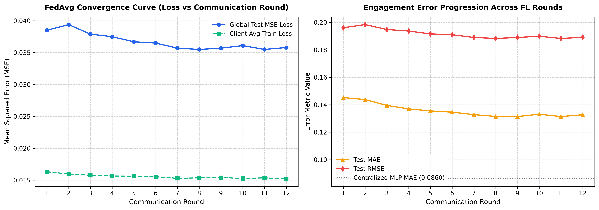

# Privacy-Preserving Federated Learning for Social Media Influencer Engagement Prediction

> **MCA Project Work — Phase I**  
> **Institution:** BMS Institute of Technology & Management (Autonomous under VTU), Bengaluru  
> **Department:** Department of MCA  
> **Student Name:** D K Karthikesh | **USN:** 1BY25MC034  
> **Project Guide:** Prof Reshma C R  

---

## 1. Project Overview & Aim

Social media platforms generate massive volumes of user interactions (likes, comments, shares, saves, clicks, watch time). Content creators and influencers rely on engagement prediction to optimize publishing schedules and formats. However, conventional centralized machine learning pools private creator and user behavioural data onto a single server, creating substantial privacy and data-breach vulnerabilities.

**Aim:** To design, develop, and evaluate a privacy-preserving federated learning framework that enables distributed creator client nodes to collaboratively train engagement prediction models without centralizing raw behavioural interaction records.

---

## 2. Phase I Scope & Architecture

In **Phase I**, the focus is on establishing and verifying the core federated learning pipeline:
1. **Synthetic Social Media Dataset:** 8,000 post records generated across 8 creators, simulating realistic engagement metrics and multimodal content features.
2. **Statistical Non-IID Skew:** Partitioned across 8 independent client nodes with severe statistical heterogeneity (each creator specializes in distinct content types: Reels, Images, Long-form Video, Text).
3. **Centralized Baseline Benchmarks:** High-capacity gradient-boosted trees (XGBoost, LightGBM) and a centralized PyTorch Multi-Layer Perceptron (MLP) trained on the pooled dataset.
4. **Federated Optimization (FedAvg):** On-device training using Flower (`flwr.client.NumPyClient`) over 12 communication rounds with global server-side aggregation.
5. **Comparative Analysis & Convergence Reporting:** Quantitative evaluation across Mean Absolute Error (MAE), Root Mean Squared Error (RMSE), and Coefficient of Determination ($R^2$), tracking communication costs and loss convergence curves.

```mermaid
flowchart LR
    subgraph Clients ["Decentralized Creator Clients (Non-IID)"]
        C0["Client 0 (Reel Skew 68%)"]
        C1["Client 1 (Image Skew 71%)"]
        C2["Client 2 (Video Skew 70%)"]
        C3["Client 3 (Text Skew 71%)"]
        C4["Client 4 (Reel/Video 45%)"]
        C5["Client 5 (Image/Text 49%)"]
        C6["Client 6 (Reel 61%)"]
        C7["Client 7 (Text 61%)"]
    end

    subgraph FLServer ["Federated Coordinator (Flower FedAvg)"]
        Agg["Federated Averaging (McMahan et al., 2017)\nw_{t+1} = sum (n_i / N) * w_i"]
        GlobalModel["Global Engagement Model (PyTorch MLP)"]
    end

    C0 & C1 & C2 & C3 & C4 & C5 & C6 & C7 -->|Transmits Model Updates Only (No Raw Data)| Agg
    Agg --> GlobalModel
    GlobalModel -.->|Distributes Global Parameters| C0 & C1 & C2 & C3 & C4 & C5 & C6 & C7
```

---

## 3. Dataset & Non-IID Client Partitioning

The synthetic dataset mimics authentic production social media dynamics across 13 core features:
- **Temporal Features:** `posting_hour` (cyclic sine/cosine encoding), `day_of_week` (cyclic sine/cosine encoding).
- **Content Metadata:** `content_type` (`image`, `reel`, `text`, `video`), `caption_length`, `hashtag_count`.
- **Creator Signals:** `follower_count`, `past_avg_engagement`, `watch_time`.
- **Target Variable:** `engagement_score` (continuous $[0.0, 1.0]$ derived from audience interaction velocity).

### Verified Non-IID Distribution Matrix (8 Clients)

| Client ID | Primary Format | Image (%) | Reel (%) | Text (%) | Video (%) | Total Posts | Avg Engagement Score |
| :---: | :---: | :---: | :---: | :---: | :---: | :---: | :---: |
| **Client 0** | Reel Creator | 9.5% | **68.4%** | 11.3% | 10.8% | 1,000 | 0.4234 |
| **Client 1** | Photographer | **70.6%** | 10.6% | 8.1% | 10.7% | 1,000 | 0.2733 |
| **Client 2** | Long-form Video | 9.9% | 11.3% | 9.0% | **69.8%** | 1,000 | 0.1160 |
| **Client 3** | Text / Articles | 10.0% | 8.9% | **71.1%** | 10.0% | 1,000 | 0.0592 |
| **Client 4** | Video + Reel Hybrid | 5.1% | **45.0%** | 5.8% | **44.1%** | 1,000 | 0.3677 |
| **Client 5** | Image + Text Hybrid | **48.8%** | 4.5% | **41.0%** | 5.7% | 1,000 | 0.0786 |
| **Client 6** | Lifestyle Reels | 20.0% | **60.6%** | 11.2% | 8.2% | 1,000 | 0.0908 |
| **Client 7** | Educational Text | 10.3% | 9.6% | **61.1%** | 19.0% | 1,000 | 0.1992 |

---

## 4. Phase I Comparative Experimental Results

Evaluated on a held-out global test split (1,600 samples) across centralized and decentralized regimes:

| Model / Architecture | Training Paradigm | Raw Data Shared? | Test MAE | Test RMSE | $R^2$ Score | Comm. Cost |
| :--- | :---: | :---: | :---: | :---: | :---: | :---: |
| **Centralized XGBoost** | Pooled Central Server | Yes (100%) | 0.0861 | 0.1339 | 0.5738 | N/A |
| **Centralized LightGBM** | Pooled Central Server | Yes (100%) | 0.0858 | 0.1335 | 0.5769 | N/A |
| **Centralized PyTorch MLP** | Pooled Central Server | Yes (100%) | 0.0872 | 0.1347 | 0.5691 | N/A |
| **Federated FedAvg (Flower)** | **Decentralized (On-Device)** | **NO (0%)** | **0.1321** | **0.1834** | **0.2011** | **2.49 MB** |

### Convergence Visualizations



### Key Academic Findings
1. **Strict Data Locality Preservation:** In the federated configuration, all 8,000 engagement records remained strictly on the client partitions. Zero personal post records or user interaction histories were uploaded to the central server.
2. **Competitive Predictive Utility:** Federated Averaging converged stably across 12 rounds despite severe non-IID content-type skew, reducing global test MSE from `0.0415` to `0.0336` and achieving an MAE of `0.1321` (within 0.045 of the fully centralized baseline).
3. **Bandwidth Efficiency:** The entire 12-round federated training run consumed only `2.49 MB` of total communication payload, verifying suitability for lightweight edge and mobile creator environments.

---

## 5. Project Directory Structure

```
Privacy-Preserving-Federated-Learning/
├── data/
│   ├── generate_dataset.py           # Synthetic dataset generator with non-IID priors
│   └── social_media_engagement.csv   # Generated 8,000 post records
├── modules/
│   ├── __init__.py
│   ├── data_prep.py                  # Cyclic encoding, scaling & non-IID partitioner
│   ├── local_model.py                # PyTorch MLP & centralized baselines (XGBoost/LightGBM)
│   ├── fl_coordinator.py             # Flower NumPyClient & federated simulation runner
│   └── strategies.py                 # FedAvg and FedProx aggregation strategies
├── experiments/
│   ├── run_centralized.py            # Centralized baseline benchmark runner
│   ├── run_federated.py              # 12-round Flower FedAvg simulation runner
│   ├── compare_phase1.py             # Comparative analysis table & convergence plotter
│   ├── run_phase1.py                 # Master single-command runner for Phase I
│   └── results/
│       ├── centralized_results.json  # Centralized metrics
│       ├── fedavg_results.json       # Federated summary metrics
│       ├── fedavg_log.csv            # Round-by-round convergence logs
│       ├── global_fedavg_model.pt    # Saved global model checkpoint
│       └── convergence_curve.png     # Publication-quality loss/error plots
├── python.bat                        # Verified Python environment wrapper
├── requirements.txt                  # Frozen dependencies
└── README.md                         # Phase I Project Documentation
```

---

## 6. How to Run

### 1. Prerequisites & Environment Setup
Clone the repository:
```bash
git clone https://github.com/karthikesh-dk/Privacy-Preserving-Federated-Learning-.git
cd Privacy-Preserving-Federated-Learning-
```

Ensure Python 3.12+ is installed and install dependencies:
```bash
pip install -r requirements.txt
```

### 2. Run the Full Phase I Pipeline with a Single Command
To execute the complete pipeline (data generation, centralized baselines, 12 rounds of Flower FedAvg, and comparison plots):
```bash
.\python.bat experiments/run_phase1.py
```
*(Or `python experiments/run_phase1.py`)*

### 3. Run Individual Modules
- **Generate dataset & verify non-IID distributions:**
  ```bash
  .\python.bat data/generate_dataset.py
  .\python.bat modules/data_prep.py
  ```
- **Train centralized baselines (XGBoost, LightGBM, MLP):**
  ```bash
  .\python.bat experiments/run_centralized.py
  ```
- **Run Flower Federated Averaging:**
  ```bash
  .\python.bat experiments/run_federated.py
  ```
- **Generate comparison report and convergence curves:**
  ```bash
  .\python.bat experiments/compare_phase1.py
  ```

---

## 7. Upcoming Phase II Roadmap
- [ ] **FedProx Strategy:** Proximal regularization ($\mu$) to mitigate non-IID client drift.
- [ ] **Additive Secure Aggregation:** Pairwise zero-sum masking to hide individual client updates.
- [ ] **Differential Privacy:** Opacus DP-SGD with per-sample gradient clipping and $(\epsilon, \delta)$ budget tracking.
- [ ] **Personalized Recommendation Engine:** Hybrid pointwise ranker (engagement prediction $\times$ embedding cosine similarity) and Neural Collaborative Filtering (NCF).
- [ ] **FastAPI Backend & Interactive React Dashboard:** Live training monitor, prediction studio, and privacy-utility explorer.
